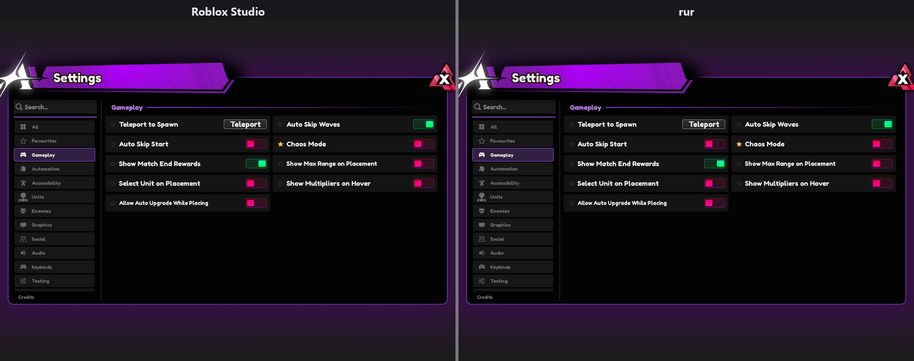
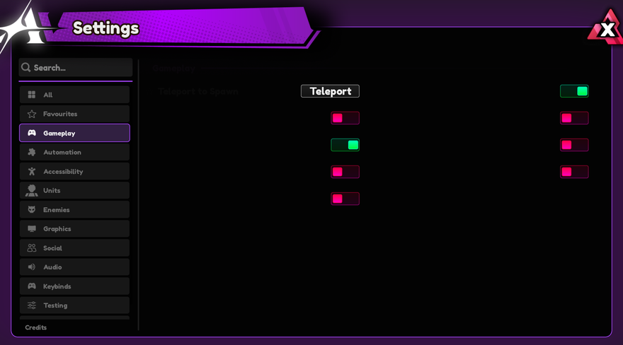
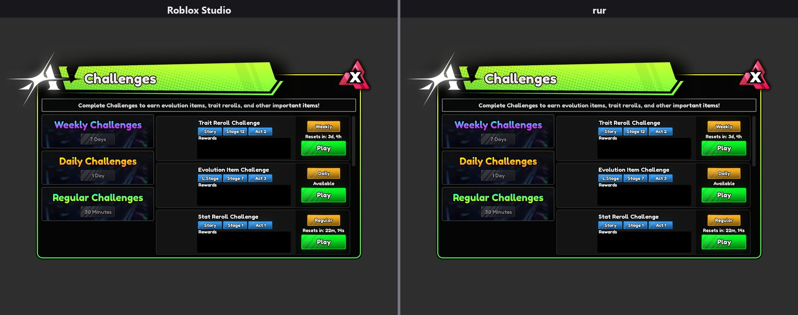
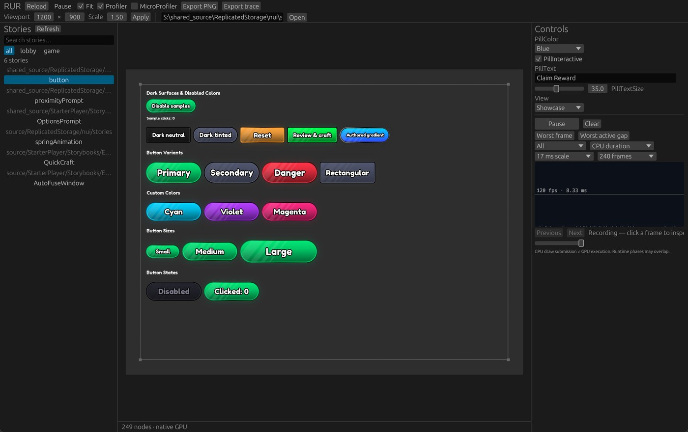

# rur: an offline Roblox UI renderer

rur runs Roblox UI outside Roblox (a UI Labs or Vide story, a Luau module that builds UI, a saved
`.rbxm` / `.rbxmx` tree, or a fixture) in an emulated engine, lays it out as the engine does and draws it
at Studio's device scale. Its layout and raster rules are measured against Roblox Studio (lossless pixel
captures and numeric dumps), so you, or a coding agent, can preview and debug a UI without opening Studio.

> [!NOTE]
> Almost all of the code here was written by AI: Claude, Anthropic's model, at its maintainers' direction. A lot of
> work went into making it correct, usable and fast for real projects (its layout and drawing are measured against
> Roblox Studio and checked by tests and golden images), but in the end Claude wrote nearly all of it.



A live Roblox game's settings window, its own Luau and assets unchanged: Roblox Studio's capture on the
left, rur's render on the right. `rur compare` measured 100% of pixels exact (no channel off by more than
2 of 255) and all 206 Studio nodes at the same rect (1200x900 at 1.5x device scale, 2026-09-30).

<a href="docs/media/settings-window.mp4"></a>

The same window running its own Luau offline, 60 frames a second with timed input (`--actions`): its rows
fade in as it opens, the pointer opens two other tabs, comes back and switches two settings on and off
again. Each frame is what `rur render --time` draws at that moment, and `rur sequence` captures such
frames in one call. [Full-quality MP4](docs/media/settings-window.mp4).

<details>
<summary>One more window from the same game</summary>



A challenges window: 100% of pixels exact, 319 of 319 nodes at the same rect.

</details>



The desktop storybook (`rur native`): pick a story from the project's catalog, use it with the mouse and
keyboard, and change its UI Labs controls while it runs.

## What it does

- **Renders** `render.png` at Studio's pixels and `scene.json` with every node's rect, visuals, text glyph
  positions and draw order, from one command or a warm local render service.
- **Shows** stories live in a desktop storybook, with input, controls and a profiler, and in a web page
  (WebAssembly).
- **Replays** timed input scripts, captures animations frame by frame as PNGs, a layout trace and videos,
  and renders the same story before and after a commit.
- **Compares** with a running Roblox Studio: side by side, per-node layout and per-pixel differences.
- **Explains** a render as text, for agents: the laid-out tree, what is at a point, zoomed crops, diffs.

## Quick start

Download a prebuilt `rur-native` zip from [Releases](https://github.com/Anime-Vanguards/roblox-ui-renderer/releases)
and extract it, or add this to `rokit.toml`:

```toml
rur-native = "Anime-Vanguards/roblox-ui-renderer@0.1.0"
```

Run `rur-native --version` to check the install. `rur-native --project <your-project>` opens the
storybook, and `rur-native render --story <story.luau> --project <your-project> --dir out/render`
renders headless. The storybook and PNG renders need a graphics driver, and fonts and textures come from
your Roblox Studio install. A release binary works on local content only: downloading assets needs the
Node CLI below. On Linux and macOS use rokit 1.0 or later, since 0.2.x cannot select an executable whose
name differs from this repository's. [Setup](docs/setup.md#release-binaries) covers the platforms, where
the state goes and how to verify a download.

To use the Node CLI or work on rur, build from a checkout. You need Rust 1.90+ with a C++ build
toolchain, Node 18+ and a Roblox Studio install, whose fonts and `rbxasset://` textures rur reads (it
ships none). [docs/setup.md](docs/setup.md) has the details.

```powershell
git clone https://github.com/Anime-Vanguards/roblox-ui-renderer
cd roblox-ui-renderer
npm install
node cli/rur.mjs render --project examples/project --story examples/project/src/ReplicatedStorage/Stories/Button.story.luau --viewport 800x400
node cli/inspect.mjs tree out/Button --depth 6
npm run native -- --project examples/project
```

The first command builds the native app (a few minutes). The render writes `out/Button/render.png`,
`scene.json` and `summary.json`; `inspect tree` prints the laid-out tree; `npm run native` opens the desktop
storybook on the example project. To use your own project, see [docs/projects.md](docs/projects.md): point
`--project` (or `RUR_PROJECT`) at it and declare its places in a `rur.json`. `node cli/rur.mjs doctor`
checks the toolchain, the build and the render service.


## Documentation

- [Setup](docs/setup.md): requirements, the native build, `rur doctor`, the state dir and output root.
- [Rendering](docs/render.md): every command; `rur render` options and output; sequences, `--git-ref`
  before/after renders, plugin UIs, whole PlayerGuis, sweeps, `rur record` and `inspect`.
- [Projects](docs/projects.md) and [stories](docs/stories.md): what a run mounts, story and fixture formats,
  controls and timed input.
- [Desktop storybook](docs/storybook.md): `rur native`, headless captures and benchmarks, memory and leaks.
- [Comparing with Studio](docs/studio.md): `rur compare` and the Studio MCP bridge it needs.
- [How a render runs and live sessions](docs/live-preview.md): the render service, kept runs, the session
  protocol and the HTTP API.
- [Browser build](docs/web.md), [assets and the cookie](docs/assets.md), [ViewportFrames](docs/viewports.md).
- The measured rules: [layout](docs/layout.md), [text](docs/text.md), [images and compositing](docs/images.md),
  [interaction](docs/interaction.md).
- [How it works](docs/how-it-works.md) (the parts, the source layout, the engine dependency) and
  [tests](docs/testing.md).

The [documentation index](docs/README.md) also says how the rules were found.

## Status and limitations

Used daily by its maintainers; Windows is the main platform. Pixel parity with Studio is high but not
complete, and interfaces may still change. On the maintainers' set of 44 stories from a live game, compared
with Studio at 1.5x device scale on 2026-09-30, 99.99994% of pixels were exact and 8,384 of 8,385 Studio
nodes were laid out at the same rect.


Limitations:

- 3D content needs a viewport worker ([docs/viewports.md](docs/viewports.md)); SurfaceGuis and
  BillboardGuis in the world are not rendered.
- A plain render captures the state after `--time`; interactive states need `--actions` or the desktop
  app's input.
- Bit-exact Studio parity is not complete: images and CanvasGroups under a rotation, some rich text styles,
  synthetic italic and image and group edge cases have small known differences.
- Stories that depend on game services or Studio-only content, yield while mounting or contain source errors
  run as far as they can; the sweep reports these separately from rendering errors.
- UIShadow `Inset` and `Mode = Text` draw as a plain outer shadow of the shape: Studio drew them so until
  0.746 and draws an inner shadow and a glow of the text since 0.747 (notes/images.md "UIShadow at Studio
  0.747"). `ShowBehindParent` is ignored.

## Contributing, security and license

- [CONTRIBUTING.md](CONTRIBUTING.md): how changes land (this repository is published from an internal one),
  setup, tests and what we can't accept. Coding agents: [AGENTS.md](AGENTS.md).
- [SECURITY.md](SECURITY.md): report vulnerabilities privately; how the Roblox cookie is handled.
- [SUPPORT.md](SUPPORT.md): where to ask. [CODE_OF_CONDUCT.md](CODE_OF_CONDUCT.md).
- The GNU General Public License, version 2 or (at your option) any later version: see [LICENSE](LICENSE) and
  [NOTICE](NOTICE). Third-party components and their licenses (FreeType, Luau, Lune, Rust crates), and why a
  built binary is distributed under GPL-3.0-or-later: [THIRD_PARTY_NOTICES.md](THIRD_PARTY_NOTICES.md).

Not affiliated with or endorsed by Roblox Corporation. Roblox and Roblox Studio are trademarks of Roblox
Corporation. Luau is a trademark of Roblox Corporation.
