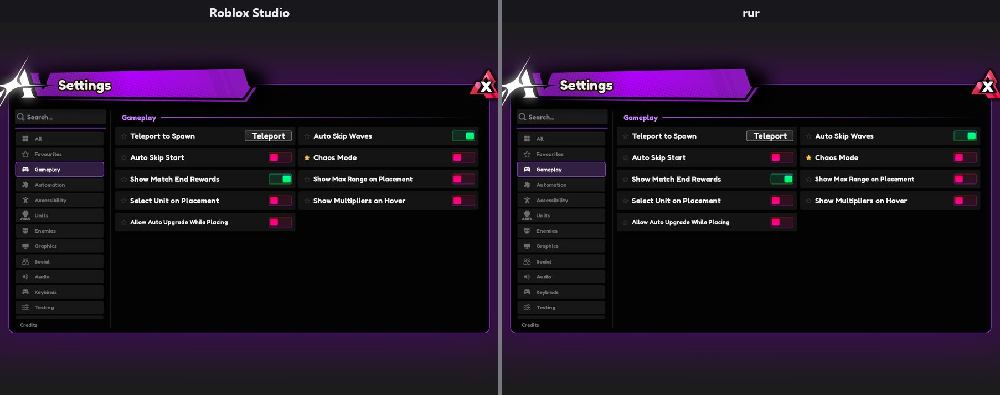
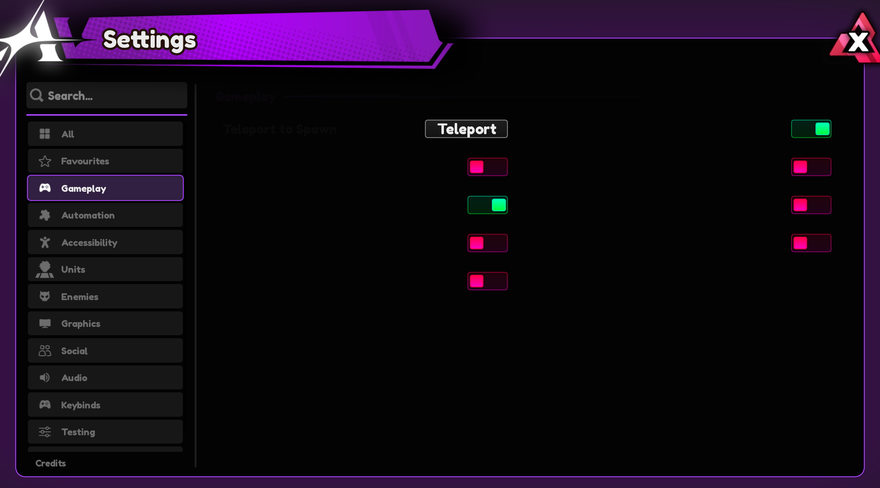
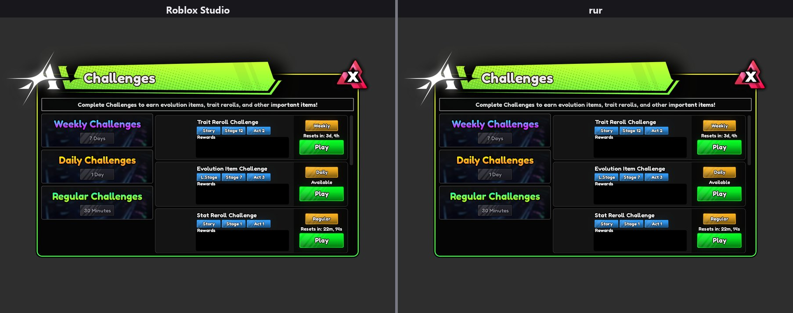
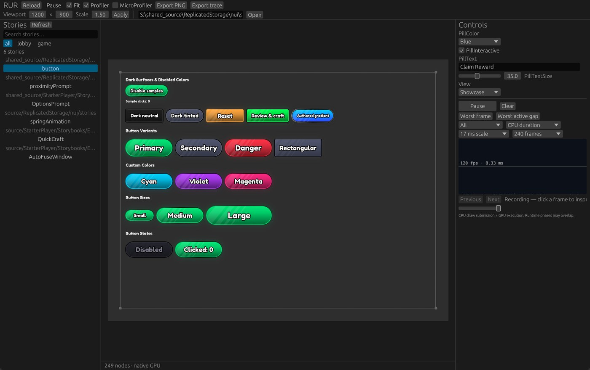

# rur — Offline Renderer for Roblox UI

`rur` runs Roblox UI code outside Roblox—supporting UI Labs, Flipbook, Vide, React/Roact, and Fusion stories, raw Luau modules, saved `.rbxm`/`.rbxmx` trees, and test fixtures—inside an emulated engine, lays it out to match Roblox Studio, and renders it at Studio's device scale.

All layout and compositing rules are calibrated against lossless Roblox Studio captures and numeric dumps, so humans and coding agents can preview, test, and debug UI without opening Studio.

> [!NOTE]
> Nearly all of the code in this repository was written by Anthropic's Claude under maintainer direction. Layout and pixel accuracy are measured against Roblox Studio and verified by automated tests and golden images, but Claude wrote almost all of the implementation.



A live game's settings window rendered from its unmodified Luau and assets: Roblox Studio on the left, `rur` on the right. `rur compare` measured **100% exact pixels** (every channel within 2/255) and **206 / 206** identical layout rects (1200x900 at 1.5x device scale, 2026-09-30).

<a href="docs/media/settings-window.mp4"></a>

The same window running offline at 60 FPS with scripted input (`--actions`): rows fade in on open, the pointer switches to Graphics and Audio, returns to Gameplay, and toggles two settings. Captured in one command via `rur sequence`. [Full-quality MP4](docs/media/settings-window.mp4).

<details>
<summary>One more window from the same game</summary>



A challenges window: 100% exact pixels and 319 / 319 identical layout rects.

</details>



The desktop storybook (`rur native`): browse project stories, interact with mouse and keyboard, tweak controls live, and inspect frame timings.

## Key capabilities

- **Pixel-accurate headless renders (`rur render`)** — Outputs `render.png` and `scene.json` (every node's rect, visual styles, glyph positions, and draw order), one-shot or via a warm local render service.
- **Interactive desktop storybook & WebAssembly build** — Preview stories live with pointer/keyboard input, reactive controls, and a built-in profiler on desktop (`rur native`) or in the browser (Wasm).
- **Animation & before/after diffs (`rur sequence`, `rur diff`)** — Replay timed input scripts, export frame-by-frame PNGs, layout traces, and MP4 videos, or compare a story at any Git commit against your working tree.
- **Studio parity checks (`rur compare`)** — Capture the same story in Roblox Studio and diff both layout rects and pixels side by side.
- **Text-first inspection (`inspect`)** — Query the laid-out tree, hit-test coordinates, generate zoomed crops, and diff two renders—built for fast human and agent debugging.

## Quick start

### Option 1: Install a release binary (`rur-native`)

Download a prebuilt zip from [Releases](https://github.com/Anime-Vanguards/roblox-ui-renderer/releases) and extract `rur-native`, or add it to `rokit.toml`:

```toml
rur-native = "Anime-Vanguards/roblox-ui-renderer@0.1.0"
```

> Use Rokit 1.0+ on Linux and macOS. Rokit 0.2.x cannot locate `rur-native` there because the executable name differs from the repository name.

For nightly builds of `main` between releases, see the [canary](https://github.com/Anime-Vanguards/roblox-ui-renderer/releases/tag/canary) prerelease (untested as a release and may break).

Verify the install and launch or render:

```sh
rur-native --version
rur-native path/to/your-project                                                # Open desktop storybook
rur-native render --story src/Button.story.luau --project . --dir out/Button   # Headless render
rur-native sweep                                                               # Render all stories & group failures
rur-native diff --git-ref HEAD --story src/Button.story.luau                   # Diff working tree vs. commit
```

What works out of the box with a release binary:
- **Rojo & Wally auto-detection:** Run inside a Rojo project folder and `rur-native` automatically mounts `default.project.json` (or the sole `*.project.json`), or pass `--rojo <file>` ([docs/projects.md](docs/projects.md#rojo-projects-and-explicit-mounts)).
- **Story frameworks:** UI Labs and [Flipbook](docs/stories.md#flipbook-stories-and-storybooks) stories (React, Roact, Fusion, Vide) work out of the box.
- **Assets & 3D viewports:** Reads built-in fonts and textures from your local Roblox Studio install, downloads uncached assets and cloud fonts automatically, and renders `ViewportFrame` 3D content via [ror](docs/viewports.md) if installed. PNG renders and the storybook require a GPU driver.
- **Bug reports:** If stories fail, run `rur-native debug-report` to generate a shareable diagnostic summary ([docs/setup.md](docs/setup.md#when-stories-fail-rur-native-debug-report)).

See [docs/setup.md](docs/setup.md#release-binaries) for supported platforms, state paths, and download verification.

### Option 2: Build from source (Node CLI + native binary)

Required for the Node CLI (`cli/rur.mjs`), Studio comparison tools, or contributing. Needs **Rust 1.90+** with a C++ toolchain, **Node 18+**, and a **Roblox Studio install** (for fonts and `rbxasset://` textures; `rur` ships none). See [docs/setup.md](docs/setup.md).

```powershell
git clone https://github.com/Anime-Vanguards/roblox-ui-renderer
cd roblox-ui-renderer
npm install
node cli/rur.mjs render --project examples/project --story examples/project/src/ReplicatedStorage/Stories/Button.story.luau --viewport 800x400
node cli/inspect.mjs tree out/Button --depth 6
npm run native -- --project examples/project
```

The first run compiles `rur-native` (takes a few minutes). `render` writes `render.png`, `scene.json`, and `summary.json` into `out/Button/`; `inspect tree` prints the laid-out hierarchy; `npm run native` opens the desktop storybook. To point at your own project, use `--project` / `RUR_PROJECT` and configure places in `rur.json` ([docs/projects.md](docs/projects.md)). Run `node cli/rur.mjs doctor` to verify your toolchain and environment.


## Documentation

- **Getting started:** [Setup & release binaries](docs/setup.md) · [Projects, places & Rojo](docs/projects.md) · [Stories, controls & actions](docs/stories.md)
- **Workflows:** [CLI rendering, sequences, sweeps & profiling](docs/render.md) · [Desktop storybook](docs/storybook.md) · [Comparing with Studio](docs/studio.md) · [Browser / WebAssembly build](docs/web.md)
- **Integrations & services:** [Live sessions & render service HTTP API](docs/live-preview.md) · [Assets, API key, cookies & broker](docs/assets.md) · [ViewportFrames with ror](docs/viewports.md)
- **Measured Studio rules:** [Layout](docs/layout.md) · [Text & fonts](docs/text.md) · [Images, CanvasGroups, strokes, gradients & shadows](docs/images.md) · [Input & scrolling](docs/interaction.md)
- **Internals:** [Architecture & emulator dependency](docs/how-it-works.md) · [Testing & goldens](docs/testing.md) · [Full docs index](docs/README.md)

## Status and known limitations

`rur` is used daily by its maintainers, with Windows as the primary platform. On a benchmark of 44 live game stories compared against Studio at 1.5x scale (2026-09-30), **99.99994%** of pixels matched within 2/255 and **8,384 / 8,385** layout rects matched exactly. CLI flags and schemas may still evolve.


Current limitations:
- **3D UI:** `ViewportFrame`s render via `ror` when installed ([docs/viewports.md](docs/viewports.md)); world-space `SurfaceGui`s and `BillboardGui`s are not rendered directly by `rur`.
- **Interactive state:** Plain `render` captures a single timestamp (`--time`); hover/click/scroll states require `--actions` or the desktop storybook.
- **Minor pixel differences:** Small sub-pixel edge differences remain on color emoji edges, single pixels at thin `Path2D` corners, rotated image edges within 0.01 px of a pixel center, single pixels of some minified semi-transparent textures (3 to 4 levels), and color steps on rotated `UIGradient`s.
- **Text rendering modes:** Roblox switches between whole-pixel and quarter-pixel text via a server flag. `rur` implements both and defaults to production's current whole-pixel mode (`--text-subpixel on` selects quarter-pixel; see [docs/text.md](docs/text.md#text-modes)).
- **Blurred text `UIShadow`:** `UIShadow` with `Mode = Text` and `BlurRadius > 0` glows from each glyph's distance field as Studio 0.747 does (color emoji in their own colors, underlines and strikethroughs too). One difference remains: in quarter-pixel text mode a glyph's glow can sit a pixel off. `Inset`, `ShowBehindParent`, and unblurred text shadows match exactly.
- **Partial story runs:** Stories relying on Studio-only instances, yielding mounts, or unemulated services run as far as they can; `rur sweep` classifies these separately from renderer bugs.

## Contributing, security, and license

- **Contributing:** [CONTRIBUTING.md](CONTRIBUTING.md) (coding agents: [AGENTS.md](AGENTS.md))
- **Security:** [SECURITY.md](SECURITY.md) (private vulnerability reporting & credential handling)
- **Support & conduct:** [SUPPORT.md](SUPPORT.md) · [CODE_OF_CONDUCT.md](CODE_OF_CONDUCT.md)
- **License:** GPL-2.0-or-later ([LICENSE](LICENSE), [NOTICE](NOTICE)). Compiled binaries bundle third-party components (FreeType, Luau, Lune, Rust crates) and are distributed under GPL-3.0-or-later; see [THIRD_PARTY_NOTICES.md](THIRD_PARTY_NOTICES.md).

Not affiliated with or endorsed by Roblox Corporation. Roblox, Roblox Studio, and Luau are trademarks of Roblox Corporation.
